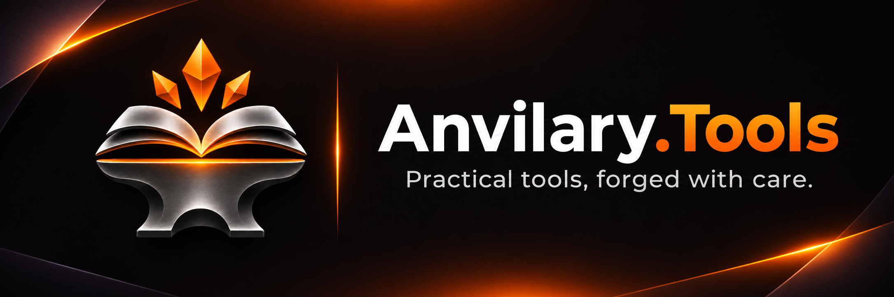

# Anvilary Tools

**Practical software forged with care.**

Anvilary Tools is an independent software initiative building focused, thoughtfully engineered applications for developers, makers, and people who value clarity, control, and practical functionality.

From AI-assisted development workflows and project planning to privacy-focused productivity tools, each product is designed to solve real problems without unnecessary complexity.

**Official Website:** [anvilary.tools](https://anvilary.tools)

---

## Our Products

### [RoadForge](https://github.com/Anvilary/RoadForge)

**Local-first roadmaps for developers, teams, and AI agents.**

RoadForge turns complex ideas into structured, actionable roadmaps. Organize projects into phases, manage tasks and dependencies, assess complexity, and track progress through a focused visual workspace.

Start without an account, collaborate with teammates when needed, and connect compatible AI coding agents through the Model Context Protocol (MCP). Public roadmap publishing also enables interactive progress sharing through GitHub and external websites.

**Key capabilities:**
- Dependency-aware roadmap planning and progress tracking.
- Optional real-time collaboration and MCP integration.
- Public roadmap sharing, portable exports, and self-hosting.

**Explore:** [Live Application](https://roadforge.anvilary.tools) · [Source & Documentation](https://github.com/Anvilary/RoadForge) · [Product Demonstration](https://github.com/Anvilary/RoadForge/issues/96)

**License:** AGPL-3.0-or-later

---

### [CVForge](https://github.com/Anvilary/CVForge)

**Build. Analyze. Improve.**

CVForge is a free, open-source CV builder and ATS-style analyzer designed around privacy, transparency, and document ownership.

Create professional resumes through structured editing and live PDF previews. Analyze document quality with transparent, deterministic scoring, and preserve editable CV sessions through portable JSON backups or compatible CVForge-generated PDFs.

Document processing runs locally in your browser, without requiring an account, subscription, or server-side CV storage.

**Key capabilities:**
- Structured CV builder with live PDF preview and customization.
- Transparent ATS-style analysis and actionable feedback.
- Recoverable PDF sessions and portable JSON backups.

**Explore:** [Live Application](https://cvforge.anvilary.tools) · [Source & Documentation](https://github.com/Anvilary/CVForge) · [Product Demonstration](https://github.com/Anvilary/CVForge/issues/4)

**License:** AGPL-3.0-or-later

---

### [OdyTor](https://github.com/Anvilary/Odytor)

**GitHub pull request review, isolated validation, and guarded maintenance for AI agents.**

OdyTor is a self-hosted Model Context Protocol (MCP) server designed for repository maintainers, engineering teams, and AI coding agents.

Inspect pull requests using bounded evidence, investigate CI failures, explore changes in disposable workspaces, and validate pinned revisions through supported isolated testing and browser workflows.

OdyTor complements general GitHub integrations with specialized engineering workflows and revision-aware maintenance operations governed by deployment-specific authorization controls.

**Key capabilities:**
- Pull request evidence collection and CI diagnosis.
- Disposable engineering workspaces and isolated validation.
- Revision-pinned maintenance and guarded publication workflows.

**Explore:** [Source & Documentation](https://github.com/Anvilary/Odytor)

**License:** AGPL-3.0-or-later

---

### [Workbench](https://github.com/Anvilary/Workbench)

**Your coding agents, terminals, and browser in one workspace.**

Workbench is a local-first desktop environment that brings existing AI coding agents, persistent terminals, projects, and native Chromium browser tabs together in a unified development workspace.

Run your installed coding CLIs using their existing authentication, organize development projects, and arrange terminal and browser sessions across flexible split panes.

A dedicated terminal supervisor helps preserve running processes across desktop application restarts, keeping long-running development workflows independent of the application window.

**Key capabilities:**
- Persistent terminal sessions and existing coding CLI integration.
- Project organization and flexible multi-pane layouts.
- Native Chromium browsing and local-first workspace management.

**Explore:** [Source & Documentation](https://github.com/Anvilary/Workbench) · [Product Demonstration](https://github.com/Anvilary/Workbench/issues/32)

**License:** AGPL-3.0-or-later (Anvilary code; see upstream MIT terms for Workbench)

---

## Our Principles

**Focused Software**

Build tools around practical problems, avoiding unnecessary features and complexity.

**User Control**

Favor local-first workflows, portable data, transparent behavior, and independence from unnecessary platform dependencies.

**Engineering Reliability**

Prioritize correctness, security, maintainability, predictable behavior, and recoverable workflows.

**Thoughtful Design**

Create minimalist, consistent, accessible interfaces that make complex functionality easier to use.

**Transparent Development**

Document capabilities, limitations, licensing, and deployment requirements accurately.

---

## Licensing & Source Availability

The four current Anvilary product repositories publish their Anvilary-owned software under the **GNU Affero General Public License v3.0 or later (AGPL-3.0-or-later)**:

- [RoadForge](https://github.com/Anvilary/RoadForge/blob/main/LICENSE)
- [CVForge](https://github.com/Anvilary/CVForge/blob/main/LICENSE)
- [OdyTor](https://github.com/Anvilary/Odytor/blob/main/LICENSE)
- [Workbench](https://github.com/Anvilary/Workbench/blob/main/LICENSE)

AGPL-3.0-or-later is an OSI-approved open-source license. It permits commercial and noncommercial use subject to its terms, including applicable corresponding-source obligations when distributing covered software or operating modified network-accessible versions.

Previously published revisions retain the licenses under which they were received, including earlier MIT-licensed versions of RoadForge, CVForge and Workbench. Workbench also includes original Agent Workbench code independently licensed under MIT; its notice and permissions are preserved in [LICENSE.UPSTREAM](https://github.com/Anvilary/Workbench/blob/main/LICENSE.UPSTREAM). Third-party components retain their own licenses.

For exact terms, scope, exceptions, and release availability, consult each project's license and documentation.

---

## Explore Anvilary

**[Official Website](https://anvilary.tools)** · **[GitHub Organization](https://github.com/Anvilary)**

Built and maintained by [Alexandre Teixeira](https://github.com/alteixeira20).
